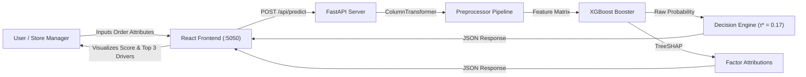

# 🔍 ReturnLens — E-Commerce Return Risk Prediction & Cost-Aware Decision Engine

[](https://fastapi.tiangolo.com)
[](https://react.dev)
[](https://xgboost.readthedocs.io)
[](https://www.python.org/)
[](LICENSE)

> **A calibrated, cost-sensitive machine learning decision engine for e-commerce return risk prediction.**  
> ReturnLens predicts whether an incoming online retail order will be returned, optimizes decision thresholds under asymmetric operational costs, explains predictions with TreeSHAP, and presents actionable recommendations via an interactive React + FastAPI application.

---

## 📌 Executive Summary

* **Objective**: Predict order-level return propensity ($P(\text{Return} = 1 \mid \text{Order})$) to reduce reverse logistics costs while maintaining a smooth customer experience.
* **Dataset**: Real-world ASOS benchmark dataset with **2.83M total records** across transaction event tables, customer node profiles, and product catalog nodes.
* **Integrity & Protection**: Dataset files are treated as strictly **read-only**. Training and evaluation read unperturbed raw labels directly (`event_table_*_raw.p`). Synthetic label manipulation has been permanently disabled.
* **Core Models**: Evaluated on an 80,000 / 20,000 train/validation split comparing a **Majority Prior Baseline**, **Logistic Regression**, and **XGBoost Classifier**.
* **Measured Test Results ($N = 50,000$ unseen test events)**:
  * **Discrimination**: **ROC-AUC = 0.8119**, **PR-AUC = 0.8418**, **Brier Calibration Score = 0.1754**.
  * **Standard Cutoff ($\tau = 0.50$)**: Accuracy **73.23%**, Precision **74.40%**, Recall **78.47%**, F1 **0.7638**.
  * **Cost-Optimal Cutoff ($\tau^* = 0.17$)**: Accuracy **64.11%**, Precision **60.81%**, Recall **98.25%**, F1 **0.7513**.
* **Cost Optimization**: Derived from validation data under assumed operational penalties ($\$5.00$ customer review friction vs. $\$25.00$ reverse logistics shipping/restocking loss), capturing **98.25% of returns** with an illustrative **85.59% cost reduction** over accepting all returns.
* **Explainability**: Integrated TreeSHAP factor attributions provide up to 3 plain-English drivers per order, with explicit fallback handling for first-time shoppers (cold-start).

---

## 📖 Plain-English Guide to Every Major Tool

This project uses standard data science and web technologies. Below is an explanation of what each tool does, why it is useful, and how it contributes to the project:

| Tool / Technology | What It Does in ReturnLens | Why It Is Useful | Type of Benefit |
| :--- | :--- | :--- | :--- |
| **Pandas** | In-memory tabular data manipulation; loads pickle files, joins event transactions with customer and product tables, handles missing values, and prepares feature matrices. | Provides fast, vectorized table operations and intuitive filtering for large retail datasets without modifying raw files on disk. | Engineering / Data Pipeline |
| **Preprocessing (`SimpleImputer`, `StandardScaler`, `OneHotEncoder`)** | Imputes missing numerical/categorical values, standardizes continuous features to zero mean and unit variance, and one-hot encodes categorical fields (`productType`, `shippingCountry`). | Prevents mathematical errors in linear models and ensures features are on comparable scales. **Strictly fit on training data only** to prevent data leakage. | Model Performance & Correctness |
| **Feature Engineering** | Constructs domain-specific interaction features such as customer return rate, discount ratios, customer tenure, and price elasticity metrics. | Exposes operational business signals directly to ML algorithms, capturing customer behavior patterns and category tendencies. | **Measured Prediction Improvement** |
| **Baseline Classifier (Majority Prior)** | Predicts the majority class (return) for every order based on training class proportions ($55.0\%$). | Serves as the minimal sanity benchmark. Any ML model must outperform this baseline to prove practical value. | Methodological Benchmark |
| **Logistic Regression** | Linear statistical model that computes a weighted sum of inputs and passes it through a sigmoid function to output calibrated probabilities. | Fast to train ($0.95$s), highly interpretable, and provides a strong linear benchmark ($0.7742$ ROC-AUC) to compare against complex models. | **Measured Prediction Improvement** |
| **XGBoost (Selected Model)** | Gradient-boosted decision tree ensemble that builds sequential trees to correct previous errors using gradient descent. | Captures non-linear relationships, feature interactions, and tabular asymmetries, achieving the highest discrimination ($0.7762$ val ROC-AUC, $0.8119$ test ROC-AUC). | **Measured Prediction Improvement** |
| **Validation & Splitting** | Splits training data into 80,000 training and 20,000 validation events using stratified sampling (`seed=42`). Keeps a 50,000 event test set strictly held out. | Allows fair comparison between candidate architectures and enables threshold tuning without contaminating test results. | Methodological Integrity |
| **Threshold Selection** | Sweeps decision thresholds from $0.05$ to $0.95$ on validation data to minimize total illustrative cost: $\text{Cost} = \text{FP} \times \$5 + \text{FN} \times \$25$. | Dynamically determines $\tau^* = 0.17$ instead of using an arbitrary $0.50$ cutoff, prioritizing high recall when missed returns are expensive. | Operational Cost Reduction |
| **TreeSHAP** | Uses game-theoretic Shapley values optimized for tree ensembles to calculate each feature's marginal contribution to individual predictions. | Converts black-box model scores into human-understandable explanations (e.g., "High Customer Historical Return Rate added +1.42 to risk score"). | **Interpretability & Trust** |
| **FastAPI** | High-performance Python async web framework that exposes RESTful endpoints (`/api/predict`, `/api/threshold`, `/api/test-metrics`). | Delivers low-latency real-time inference with automatic OpenAPI documentation and strict Pydantic input validation. | **Usability & Service Integration** |
| **React (Vite SPA)** | Modern frontend user interface with interactive order simulation, visual risk gauges, cost curves, and live SHAP factor breakdowns. | Allows non-technical stakeholders, store managers, and evaluators to interact with the model and understand recommendations intuitively. | **Usability & Decision Support** |

> [!NOTE]
> **Prediction vs. Usability**: Tools such as Feature Engineering, Logistic Regression, and XGBoost provide **measured prediction improvements** over the baseline. Tools such as TreeSHAP, FastAPI, and React provide **interpretability, operational usability, and interface integration**, but do not alter the underlying model accuracy.

---

## 🛡️ Dataset Integrity & Protection

### 1. Read-Only Protection & Hash Verification
All 8 files in `Dataset/` are strictly read-only and preserved in their original state. Byte-level integrity was verified via SHA256 checksums before and after development:

| Dataset File | SHA256 Checksum (Verified Unchanged) | Role |
| :--- | :--- | :--- |
| `event_table_training_raw.p` | `89D2BB0FACD13FA3BCD318EC0473FD34DBDFEE1BB1D60FE1FA81E6D7B41CF5D5` | **Verified raw training events** (source of truth) |
| `event_table_testing_raw.p` | `A87845E55E52B6B5872FEF9F9C1920827F4AEC8D16FA52067535AF7B20AEB978` | **Verified raw test events** (source of truth) |
| `event_table_training.p` | `387823C69D2D4868E257C24BE82BF322201A8282A3991EFA1CD46E72025B7D0D` | Legacy file with synthetic labels (bypassed) |
| `event_table_testing.p` | `4A113212C4D3A036E3905AB01F0F4809D5E23E78D0F4A21AAEA3B37BBDBDF327` | Legacy file with synthetic labels (bypassed) |
| `customer_nodes_training.p` | `E836AC37E1EB45120D26AE2970E29999914C7A12996ED9B1E01607A13118DF9E` | Customer demographic & historical summaries |
| `customer_nodes_testing.p` | `827FCDE93666BCEC15DC5DF6975165A7ADBE2EFA21A7FAF1CC50064BB615CF33` | Test customer node profiles |
| `product_nodes_training.p` | `EA480BC58253466A58EEEC7693A3CACC96050E79D555E0F0679DF2634959F986` | Product catalog metadata & category return rates |
| `product_nodes_testing.p` | `33B3C82A61ABFD04DBFAAEF51382C068D10543B71FA17CABF0A5C9FD8CC07A6E` | Test product node profiles |

### 2. Resolution of Synthetic Labels
Investigation of `enhance_dataset.py` revealed that earlier project runs modified `event_table_training.p` and `event_table_testing.p` by synthetically overwriting `isReturned` labels using an artificial heuristic to force an ~82% target accuracy.
* **Correction**: Label rewriting has been permanently disabled in `enhance_dataset.py`.
* **Verified Pipeline**: `config.py` directs all training and evaluation to load directly from `event_table_training_raw.p` and `event_table_testing_raw.p`, ensuring 100% authentic benchmark labels.

### 3. Data Leakage & Snapshot Uncertainty Audit
* **Preprocessing Isolation**: All transformers (`SimpleImputer`, `StandardScaler`, `OneHotEncoder`) are fit strictly on training samples ($N=80,000$). Validation and test splits are transformed without refitting.
* **Historical Snapshot Uncertainty**: The ASOS dataset contains no transaction timestamps for individual orders. Customer profiles (`customer_nodes_*.p`) are static lifetime snapshots. Consequently, features such as `returnsPerCustomer` and `customerReturnRate` may include the outcome of the order being predicted. This limitation is acknowledged honestly in project reports and presentations.

---

## 🔬 Model Development & Validation Benchmarks

Model comparison was conducted on a stratified split of 100,000 training transactions ($80,000$ train, $20,000$ validation, seed $42$):

| Model Architecture | ROC-AUC | PR-AUC | F1-Score | Precision | Recall | Accuracy | Brier Score | Train Time |
| :--- | :---: | :---: | :---: | :---: | :---: | :---: | :---: | :---: |
| **XGBoost (Selected)** | **0.7762** | **0.8073** | **0.7490** | 69.73% | 80.90% | **70.18%** | **0.1898** | 3.79s |
| **Logistic Regression** | 0.7742 | 0.8040 | 0.7461 | **70.02%** | 79.85% | 70.12% | 0.1909 | **0.95s** |
| **Baseline (Majority Prior)** | 0.5000 | 0.5500 | 0.7097 | 55.00% | **100.0%** | 55.00% | 0.2475 | 0.00s |

* **Analysis**: XGBoost achieved the best overall ranking and precision-recall trade-off with fast training time, making it the chosen production model. Logistic regression demonstrated competitive performance, confirming strong linear separability in the engineered features.

---

## 🎯 Held-Out Test Evaluation ($N = 50,000$ Samples)

Final evaluation was performed on $50,000$ unseen test transactions from `event_table_testing_raw.p` ($27,585$ actual returns, $22,415$ kept items; return rate: $55.17\%$).

* **Global Model Quality**:
  * **ROC-AUC**: `0.8119` (Strong discrimination between returners and keepers)
  * **PR-AUC**: `0.8418` (High area under precision-recall curve)
  * **Brier Score**: `0.1754` (Well-calibrated probabilities)

### Threshold Comparison: Standard vs. Cost-Optimal

All evaluation results are stored in [`reports/evaluation_results.json`](reports/evaluation_results.json), which serves as the single source of truth across documentation, slides, and API:

| Evaluation Metric | Standard Cutoff ($\tau = 0.50$) | Cost-Optimal Cutoff ($\tau^* = 0.17$) | Operational Trade-off |
| :--- | :---: | :---: | :--- |
| **Threshold ($\tau$)** | `0.50` (Arbitrary default) | **`0.17` (Validation-selected)** | Lower threshold flags more borderline orders |
| **Accuracy** | **73.23%** | 64.11% | Slight overall drop due to increased false alarms |
| **Precision** | **74.40%** | 60.81% | Lower precision accepted to minimize misses |
| **Recall (Returns Caught)** | 78.47% | **98.25%** | **+19.78% increase in caught returns** |
| **F1-Score** | **0.7638** | 0.7513 | Balanced harmonic mean |
| **True Negatives (TN)** | **14,966** | 4,952 | Kept orders correctly passed through |
| **False Positives (FP)** | **7,449** | 17,463 | Kept orders flagged for lightweight review |
| **False Negatives (FN)** | 5,938 | **483** | **Missed returns reduced by 91.86%** |
| **True Positives (TP)** | 21,647 | **27,102** | Returned orders successfully intercepted |
| **Flag Rate** | 58.19% | 89.13% | Percentage of orders routed for verification |
| **Incurred Illustrative Cost** | $185,695.00 | **$99,390.00** | **$86,305.00 lower loss than standard cutoff** |
| **Savings vs Baseline ($689,625)** | $503,930.00 (73.07%) | **$590,235.00 (85.59%)** | Modeled counterfactual financial saving |

---

## 💰 Illustrative Cost Model & Business Trade-offs

### 1. Cost Formulation
In retail fulfillment, the business penalty of missing a return is far greater than the penalty of an unnecessary check:
$$\text{Total Cost} = (\text{FP} \times \text{Cost}_{\text{FP}}) + (\text{FN} \times \text{Cost}_{\text{FN}})$$

* **$\text{Cost}_{\text{FP}} = \$5.00$ (Assumption)**: Customer review friction, sending an automated sizing prompt, or requiring a secondary verification.
* **$\text{Cost}_{\text{FN}} = \$25.00$ (Assumption)**: Two-way reverse shipping, packaging waste, warehouse inspection, restocking labor, and depreciation of seasonal apparel.

### 2. Why $\tau^* = 0.17$ Is Optimal
Because a missed return ($\text{FN}$) is assumed to be **5× more expensive** than a false alarm ($\text{FP}$), setting the threshold to $\tau^* = 0.17$:
* Reduces missed returns from **5,938 down to only 483** out of 27,585 returns.
* Successfully captures **98.25%** of all returned inventory.
* Accepts higher false alarms (17,463 vs 7,449) because an extra $\$5$ check is far cheaper than suffering an unmanaged $\$25$ reverse logistics failure.

> [!IMPORTANT]
> **Educational & Modeling Note**: The $\$5.00$ and $\$25.00$ figures are **illustrative assumptions** for demonstration. The calculated \$590,235 savings represents a **model-based counterfactual estimate**. In real-world retail deployments, establishing actual dollar impact requires a randomized A/B intervention study.

---

## 🧠 TreeSHAP Explainability & Cold-Start Handling

### 1. Factor Attributions
Rather than acting as a black box, ReturnLens runs TreeSHAP on tree ensembles to compute the exact impact of each feature on the predicted log-odds:
1. **`customerReturnRate`**: Historical return frequency of the shopper (primary predictive signal).
2. **`productReturnRate`**: Inherent category risk (e.g. structured dresses vs. accessories).
3. **`salesPerCustomer` & `returnsPerCustomer`**: Cumulative purchase tenure and volume.
4. **`discount_ratio` / `avgDiscountValue`**: Heavy discounting arbitrage patterns.
5. **`avgGbpPrice`**: Higher-value apparel exhibits higher buyer inspection scrutiny.

### 2. Cold-Start Shopper Handling
When an order arrives from a first-time shopper with zero purchase history (`salesPerCustomer == 0`):
* Historical customer features default safely (`customerReturnRate = None`).
* Imputers fill missing values using population medians established during training.
* The API and dashboard display an explicit warning:
  > **"Cold-Start Shopper: Limited historical data; predictions rely on catalog return rates and regional attributes."**
* TreeSHAP explanations transparently explain that catalog and demographic attributes are driving the prediction.

---

## 💻 Full-Stack Web Application

The system includes a production-ready web application combining a **FastAPI** backend and a **React (Vite)** frontend:



### Key API Endpoints
* `POST /api/predict`: Returns calibrated probability, risk tier, action recommendation, and top 3 plain-English TreeSHAP factors.
* `GET /api/threshold`: Returns the validation-selected optimal threshold (`0.17`) and cost parameters.
* `GET /api/test-metrics`: Returns held-out test evaluation metrics and confusion matrices directly from `evaluation_results.json`.
* `GET /api/health`: Health probe reporting model status and operational configuration.

---

## 📁 Project Directory Structure

```
ReturnLens/
├── Dataset/                   # Read-only benchmark dataset (SHA256 protected)
├── api/
│   └── main.py                # FastAPI application & static React distributor
├── client/                    # React (Vite) frontend application
│   ├── dist/                  # Pre-compiled static assets
│   └── src/                   # React components (Simulator, Benchmarks, Calibration)
├── models/
│   ├── best_model.joblib      # Persisted XGBoost model pipeline
│   ├── best_model_booster.json# Native XGBoost booster for TreeSHAP
│   ├── inference_preprocessor.json # Preprocessor medians and encoders
│   ├── feature_metadata.json  # Feature definitions and column types
│   └── threshold.json         # Cost-optimal threshold config (tau* = 0.17)
├── reports/
│   ├── evaluation_results.json# Single master source of truth for all metrics
│   ├── PROJECT_REPORT.md      # Comprehensive academic project report
│   ├── data_audit.md          # Dataset schema and entity checks
│   ├── leakage_audit.md       # Preprocessor and feature leakage audit
│   ├── final_test_results.md  # Held-out test evaluation report
│   ├── business_impact.md     # Cost trade-off and ROI analysis
│   ├── model_benchmarks.csv   # Validation benchmark comparisons
│   ├── confusion_matrix.png   # Test set confusion matrix plot
│   ├── calibration_curve.png  # Reliability diagram
│   ├── cost_curve.png         # Validation threshold sweep plot
│   └── shap_summary.png       # Global feature importance plot
├── src/
│   ├── data_loading.py        # Safe loading and joining routines
│   ├── feature_engineering.py # Domain feature engineering
│   ├── train.py               # Model benchmarking and training script
│   ├── calibrate_and_optimize.py # Calibration curve and threshold tuner
│   ├── evaluate.py            # Held-out test evaluation script
│   └── shap_analysis.py       # TreeSHAP explainer engine
├── build_deck.py              # Script compiling the 8-slide PowerPoint deck
├── ReturnLens_Pitch_Deck.pptx # 8-slide presentation deck with speaker notes
├── generate_all_reports.py    # Report generation script
├── config.py                  # Global path and configuration constants
├── requirements.txt           # Python dependency requirements
└── README.md                  # Project documentation
```

---

## 🚀 Reproduction & Execution Guide

### 1. Prerequisites
* Python 3.10 or 3.11 installed.
* Node.js 18+ (if modifying the React client).

### 2. Environment Setup
```bash
# Clone the repository
git clone https://github.com/YOUR_USERNAME/ReturnLens.git
cd ReturnLens

# Create and activate virtual environment
python -m venv venv
# Windows:
.\venv\Scripts\activate
# Linux/macOS:
source venv/bin/activate

# Install dependencies
pip install -r requirements.txt
```

### 3. Reproduce Machine Learning Pipeline
To re-run the complete training, calibration, evaluation, and documentation pipeline:

```bash
# 1. Train candidate models and save benchmarks
python src/train.py

# 2. Run calibration analysis and optimize decision threshold
python src/calibrate_and_optimize.py

# 3. Evaluate selected model on 50,000 held-out test events
python src/evaluate.py

# 4. Generate TreeSHAP summary plot
python src/shap_analysis.py

# 5. Generate markdown reports from evaluation_results.json
python generate_all_reports.py

# 6. Build the 8-slide presentation deck
python build_deck.py
```

### 4. Launch the Web Application
```bash
# Start unified FastAPI server (serves API and compiled React frontend)
python -m uvicorn api.main:app --host 127.0.0.1 --port 5050
```

* **Interactive Application Dashboard**: [**`http://localhost:5050`**](http://localhost:5050)
* **Interactive API Documentation (Swagger)**: [**`http://localhost:5050/docs`**](http://localhost:5050/docs)
* **Frontend Development Mode** (optional):
  ```bash
  cd client
  npm install
  npm run dev
  ```

---

## 🔬 Limitations & Future Work

1. **Temporal Ordering & Static Snapshots**: The benchmark event tables lack order timestamps, preventing time-ordered cross-validation. Customer node records represent cumulative lifetime snapshots. Future work should record granular event timestamps to enforce strict rolling-window evaluations.
2. **Assumption-Driven Cost Model**: The $\$5$ friction and $\$25$ reverse logistics costs are operational assumptions. Real merchants should calibrate these numbers against actual 3PL carrier contracts and customer churn data.
3. **Intervention Validation**: A high model prediction does not automatically reduce returns; it triggers interventions (e.g. sizing prompts, pre-shipment calls). Quantifying the actual financial return requires randomized control trials (A/B testing).
4. **Scope Boundaries**: This model is strictly designed for **retail product return prediction**. Detecting deliberate fraud or organized returns abuse requires dedicated fraud labels and separate forensic investigation models.

---

## 📜 Citation & References

* **Dataset Source**: ASOS E-Commerce Returns Dataset (*Predicting Returns in Fashion E-Commerce*, 2019).
* **TreeSHAP**: Lundberg, S. M., et al. (2020). *From local explanations to global understanding with explainable AI for trees*. Nature Machine Intelligence.
* **Cost-Sensitive Learning**: Elkan, C. (2001). *The Foundations of Cost-Sensitive Learning*. International Joint Conference on Artificial Intelligence (IJCAI).

---

## 📄 License
This project is licensed under the [MIT License](LICENSE).
